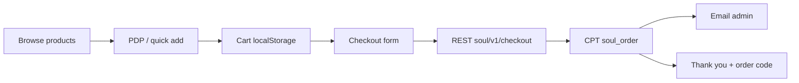

# SOUL Fine Robusta — BRD (Business Requirements Document)

| | |
|---|---|
| **Sản phẩm** | Website soulcoffee.vn (WordPress) |
| **Thương hiệu** | SOUL / Soul Specialty Coffee / SOUL Fine Robusta |
| **Nguồn UI** | `html/` (local, không git) |
| **Nơi build** | `wordpress/wp-content/themes/soul` |
| **Phiên bản BRD** | 1.0 · 2026-11-19 |
| **Trạng thái** | **Đã duyệt** (2026-11-19) — thực thi theo [`ROADMAP.md`](ROADMAP.md) |

Tài liệu kỹ thuật ngắn: [`PROJECT.md`](PROJECT.md) · Pattern catalog: [`../PATTERN-SYSTEM/`](../PATTERN-SYSTEM/) · Plan pha: [`ROADMAP.md`](ROADMAP.md)

---

## 1. Mục tiêu & phạm vi

### 1.1 Mục tiêu kinh doanh

1. Trình bày thương hiệu Fine Robusta / Soul (story, awards, Soulful, spaces).
2. **Listing sản phẩm** theo collection + trang chi tiết.
3. **Thu thập đơn hàng** (lead order): khách gửi đơn → lưu trong WP Admin → Soul liên hệ xác nhận.
4. Hỗ trợ B2B (Coffee Solutions + form liên hệ / báo giá nhân xanh).
5. Nội dung blog / kiến thức / tuyển dụng; đa ngôn ngữ VI (chính) + EN.

### 1.2 Trong phạm vi (In scope)

- Marketing pages (pattern-first Gutenberg).
- Catalog CPT (không WooCommerce).
- Giỏ hàng client + checkout form → CPT đơn hàng.
- Phương thức trên đơn: **COD** và/hoặc **chuyển khoản** chỉ là lựa chọn lưu trữ — **không** tích hợp cổng thanh toán (không VNPay/MoMo/thẻ).
- Admin quản lý sản phẩm, collection, đơn hàng, trang, bài viết.
- i18n VI/EN (pha sau có thể plugin).
- Design system Soul (tokens, typography, chrome).

### 1.3 Ngoài phạm vi (Out of scope) — v1

- WooCommerce / Shopify / Haravan runtime.
- Thanh toán online / hoàn tiền tự động / hóa đơn điện tử tự động.
- App mobile, membership phức tạp, loyalty points.
- Đa kho / inventory realtime / ERP sync.
- Commit thư mục `html/` lên git.

### 1.4 Quyết định đã chốt

| Quyết định | Giá trị |
|---|---|
| CMS | WordPress |
| Theme | `soul`, pattern-first |
| Commerce | CPT `soul_product` + `soul_order` |
| Payment | Không gateway; lưu preference COD / bank |
| UI prototype | `html/` local reference only |
| Pattern rule | skill `wordpress-pattern-first` |

> **Lệch prototype Help:** bản HTML ghi “không COD + có VNPay/MoMo”. **BRD ưu tiên quyết định product:** không gateway; COD/bank là nhãn trên đơn. Copy Help/Payment phải chỉnh cho khớp khi build trang Help.

---

## 2. Personas & kênh

| Persona | Nhu cầu chính |
|---|---|
| Khách B2C | Xem cà phê rang, Soulful, đặt hàng, giao/đổi trả |
| Barista / home brew | Cách pha, tasting notes, phụ kiện |
| Chủ quán / HORECA | Horeca Collection, training, wholesale |
| Nhà rang B2B | Nhân xanh, báo giá >60kg, mẫu 1–5kg |
| Visitor café | Tìm cửa hàng, giờ mở, không khí |
| Editor Soul | Sửa trang bằng Gutenberg patterns, không cần dev |

---

## 3. Sitemap (thông tin kiến trúc)

### 3.1 Cây URL mục tiêu

```
/                                 Home
/products/                        Shop — tất cả sản phẩm
/collections/{slug}/              Collection listing
/products/{slug}/                 Product detail (PDP)
/checkout/                        Giỏ + gửi đơn (order capture)
/our-story/                       Về Soul
/coffee-solutions/                Giải pháp B2B
/spaces/                          Hub cửa hàng
/spaces/{branch}/                 Chi nhánh (hoặc /spaces/#{id} → permalink riêng)
/blog/                            Blog index
/blog/{slug}/                     Bài viết
/blog/category/{slug}/            Category (news, magazine, how-to, recruitment, achievements)
/help/                            FAQ
/help/shipping/                   Giao hàng
/help/returns/                    Đổi trả
/help/payment/                    Thanh toán (copy: bank/COD — không gateway)
/help/privacy/                    Bảo mật
/help/terms/                      Điều khoản
/help/contact/                    Liên hệ hỗ trợ
/search/?q=                       Tìm kiếm
/account/                         (Pha sau — tùy chọn; v1 có thể chỉ tra cứu mã đơn)
/new-crop/                        Landing mùa vụ (campaign)
/404                              Không tìm thấy
```

### 3.2 Primary navigation

| # | VI | EN | Target |
|---|---|---|---|
| 1 | Trang chủ | Home | `/` |
| 2 | Sản phẩm | Shop | `/products/` (+ mega: roasted / green / Soulful) |
| 3 | Mùa vụ mới | New Crop | `/collections/soulful-flavours/` hoặc `/new-crop/` |
| 4 | Về Soul | Our Story | `/our-story/` |
| 5 | Giải pháp cà phê | Coffee Solutions | `/coffee-solutions/` |
| 6 | Cửa hàng | Spaces | `/spaces/` |
| 7 | Blog | Blog | `/blog/` |

**Utility:** Search · Cart/Checkout · (Account — pha sau)

### 3.3 Footer IA (4 cột)

1. **Shop** — Cà phê rang, Nhân xanh, Soulful, Tất cả  
2. **Khám phá** — Our Story, Spaces, Blog  
3. **Đối tác** — Solutions, Nhân xanh services, Mua sỉ (#contact)  
4. **Hỗ trợ** — Giao hàng, Đổi trả, FAQ, Liên hệ  

### 3.4 Collections (taxonomy `soul_collection`)

| Slug | VI | Ghi chú |
|---|---|---|
| `ca-phe-rang` | Cà phê rang | Parent roasted |
| `soulful-flavours` | Soulful Collection 2026 | Seasonal |
| `origin-collection` | Origin Collection | |
| `ca-phe-chat-luong-cao` | Horeca Collection | 1kg packs |
| `ca-phe-pha-phin` | Cà phê pha phin | |
| `ca-phe-pha-may` | Cà phê pha máy | |
| `ca-phe-pha-dung-cu` | Cà phê pha dụng cụ | |
| `ca-phe-u-lanh-cold-brew` | Cà phê ủ lạnh | |
| `ca-phe-nuoc-ngoai` | Cà phê nước ngoài (Arabica) | |
| `phu-kien` | Phụ kiện | |
| `hop-qua-combo` | Hộp quà combo | |
| `ca-phe-nhan-xanh` | Cà phê nhân xanh | Quote flow |
| `fine-robusta` | Fine Robusta | Green child |
| `high-quality-robusta` | High Quality Robusta | |
| `specialty-arabica` | Specialty Arabica | |
| `high-quality-arabica` | High Quality Arabica | |
| `liberica` | Liberica | |
| `san-pham-noi-bat` | Sản phẩm nổi bật | Curated |
| `san-pham-moi` | Sản phẩm mới | Curated |

### 3.5 Spaces (5 chi nhánh)

| ID | Tên |
|---|---|
| `bmt` | Soul Buôn Ma Thuột |
| `hcm` | Soul Sài Gòn |
| `hn` | Soul Hà Nội |
| `dn` | Soul Đà Nẵng |
| `bn` | Soul Bà Nà |

### 3.6 Home sections (nội dung)

| # | Section | Mục đích |
|---|---|---|
| 01 | Hero | Brand + CTA shop / story |
| 02 | Shop tiles | Roasted / green entry |
| 03 | Featured | Sản phẩm nổi bật + ATC |
| 04 | Story + album | Craft narrative + lightbox |
| 05 | Why / pillars | 4 proof points |
| 06 | Awards rail | Certs + photos |
| 07 | Soulful 2026 | Cay · Nồng · Thơm · Ngọt |
| 08 | Solutions teaser | B2B services + form |
| 09 | Spaces teaser | 5 stores |
| 10 | Newsletter | Yellow band |
| — | Footer | |

---

## 4. Feature backlog (chi tiết)

Mỗi feature: **ID · Mô tả · Acceptance · Ưu tiên · Phụ thuộc**.

### 4.1 Nền tảng (Foundation)

| ID | Feature | Acceptance | Prio |
|---|---|---|---|
| F-01 | Theme `soul` pattern-first | Header/footer, tokens, editor styles, activate | P0 |
| F-02 | Docker local | WP + DB + Mailpit chạy ổn định | P0 |
| F-03 | Permalink + `.htaccess` | `/products/`, `/checkout/` 200 | P0 |
| F-04 | Design tokens / chrome CSS | Ink/paper/yellow/clay; sticky header 66px | P0 |

### 4.2 Catalog & listing

| ID | Feature | Acceptance | Prio |
|---|---|---|---|
| F-10 | CPT `soul_product` | Title, content, image, price, SKU, notes, meta, stock, variants JSON | P0 |
| F-11 | Taxonomy `soul_collection` | Full slug list §3.4; archive filter chips | P0 |
| F-12 | Product archive | Grid 10px gutter; card: image, badge, name, notes, price, ATC/link | P0 |
| F-13 | PDP | Gallery, variants, qty, ATC, story, related (cùng collection) | P0 |
| F-14 | Green / quote CTA | Sản phẩm green: “Liên hệ báo giá” → Solutions contact (không ATC hoặc ATC mẫu nhỏ) | P1 |
| F-15 | Filters | In-stock, sort (featured/new/price), search trong collection | P1 |
| F-16 | Seed / import catalog | Import từ prototype Shop (≥ mẫu đại diện mỗi collection) | P1 |

### 4.3 Cart & order capture (không payment gateway)

| ID | Feature | Acceptance | Prio |
|---|---|---|---|
| F-20 | Cart localStorage | Add / qty / remove; count trên header; key namespaced | P0 |
| F-21 | Cart drawer (optional UX) | Drawer từ header; CTA → `/checkout/` | P1 |
| F-22 | Checkout page | Xem dòng hàng + form: tên, email, SĐT, địa chỉ, ghi chú | P0 |
| F-23 | Payment preference | Radio: `cod` \| `bank` — lưu meta đơn, **không** charge | P0 |
| F-24 | REST tạo đơn | `POST /wp-json/soul/v1/checkout` → CPT `soul_order` + mã `SOUL-{id}` | P0 |
| F-25 | Admin Orders | List: mã, khách, status badge, payment, ship, total + filter/bulk; detail: customer/geo, shipping, VAT, lines/totals, tracking, notes; status `new\|confirmed\|shipping\|done\|cancelled` + `payment_status` unpaid/paid | P0 |
| F-26 | Email thông báo | `wp_mail` admin khi đơn mới (Mailpit local) | P0 |
| F-27 | Validation | Bắt buộc name + email hợp lệ + phone + address; giỏ không rỗng | P0 |
| F-28 | Thank-you state | Hiện mã đơn; clear cart | P0 |
| F-29 | VAT invoice flag | Checkbox + fields công ty (lưu meta; không xuất HĐ tự động) | P2 |

### 4.4 Marketing pages (Gutenberg patterns)

| ID | Feature | Acceptance | Prio |
|---|---|---|---|
| F-30 | Home seeded + patterns | Hero, shop teaser, story, newsletter tối thiểu; đủ section theo §3.6 theo pha | P0→P1 |
| F-31 | Our Story | Manifesto, philosophy, team, Fine Robusta, channels, journey | P1 |
| F-32 | Coffee Solutions | Capacity, services, partners, contact form | P1 |
| F-33 | Spaces hub + branch | 5 stores; gallery/lightbox; address/hours | P1 |
| F-34 | Help hub | FAQ accordion + policy pages §3.1; copy khớp no-gateway | P1 |
| F-35 | New Crop landing | Campaign page / pattern | P2 |
| F-36 | 404 | Search shortcut + links Home/Shop/Spaces/Help | P1 |

### 4.5 Blog & search

| ID | Feature | Acceptance | Prio |
|---|---|---|---|
| F-40 | Blog list/single | Categories: news, soul-magazine, how-to-make-coffee, recruitment, soul-achievements | P1 |
| F-41 | Global search | Products + posts + pages; diacritic-insensitive | P2 |
| F-42 | Search overlay | Header quick search | P2 |

### 4.6 Forms & lead

| ID | Feature | Acceptance | Prio |
|---|---|---|---|
| F-50 | Newsletter | Email → lưu / mail; success state | P1 |
| F-51 | B2B contact (Home/Solutions) | Name, business, email, phone, interest chips, message | P1 |
| F-52 | Help contact | Topic + message | P1 |
| F-53 | Mailpit wiring | Local SMTP `mailpit:1025` cho mọi form | P1 |

### 4.7 i18n & account (pha sau)

| ID | Feature | Acceptance | Prio |
|---|---|---|---|
| F-60 | VI/EN toggle | Polylang Free: VI default + `/en/`; CPT/tax/menus dịch; orders không dịch; theme UI theo lang | P2 |
| F-61 | Account | Login/orders — **không bắt buộc v1**; có thể tra cứu mã đơn bằng email | P3 |
| F-62 | Order lookup | Form: email + mã đơn → xem status (không full account) | P2 |

### 4.8 Admin & ops

| ID | Feature | Acceptance | Prio |
|---|---|---|---|
| F-70 | Product metabox | Price, SKU, badge, notes, meta chain, stock, variants JSON | P0 |
| F-71 | Order CSV export | Export đơn theo khoảng ngày | P2 |
| F-72 | Media optimize | Ảnh web (không ship 5–11MB originals) | P1 |

### 4.9 Non-functional

| ID | Requirement | Acceptance | Prio |
|---|---|---|---|
| N-01 | A11y cơ bản | Focus ring vàng; skip link; Esc đóng overlay | P1 |
| N-02 | Perf | LCP ảnh tối ưu; CSS/JS theme enqueue đúng | P1 |
| N-03 | SEO | Title/meta; semantic headings; sitemap XML (Yoast/RankMath hoặc core) | P2 |
| N-04 | Security | Sanitize checkout; nonce REST; không public PII trên front | P0 |
| N-05 | Editor DoD | Tạo trang mới bằng patterns không cần `page-*.php` HTML | P1 |

---

## 5. User flows chính

### 5.1 Mua hàng (order capture)



### 5.2 Báo giá nhân xanh

```
Collection green → PDP (quote CTA) → Coffee Solutions contact
  hoặc Checkout không dùng → form B2B với interest = Nhân xanh
```

### 5.3 Editor tạo trang

```
Add page → insert page starter / section patterns → đổi copy/ảnh → Publish
```

---

## 6. Mô hình dữ liệu

### 6.1 `soul_product`

| Field | Type | Note |
|---|---|---|
| post_title | string | Tên SP |
| post_content | blocks | Story |
| thumbnail | media | |
| `soul_price` | int VND | Base price |
| `soul_sku` | string | Handle |
| `soul_badge` | string | Eyebrow |
| `soul_notes` | string | Tasting notes |
| `soul_meta_chain` | string | Origin · process · roast |
| `soul_in_stock` | 0/1 | |
| `soul_variants` | JSON | weight/grind/pack + multipliers |
| `soul_quote_only` | 0/1 | Green wholesale (P1) |
| taxonomy | `soul_collection` | |

### 6.2 `soul_order`

| Field | Type |
|---|---|
| `soul_order_code` | SOUL-{id} |
| `soul_status` | new \| processing \| done \| cancelled |
| `soul_payment` | cod \| bank |
| `soul_customer` | {name, email, phone, address, note} |
| `soul_items` | [{id, name, variant, price, qty}] |
| `soul_total` | int |
| `soul_vat` | optional object (P2) |

### 6.3 Spaces (đề xuất)

CPT `soul_space` hoặc pages + pattern: name, region, address, hours, hotline, gallery, map query, menu PDF.

### 6.4 Blog

WP posts + categories (§3.1).

---

## 7. Design & content rules (ràng buộc)

- VI first, EN ngang hàng khi bật i18n.
- Voice: nhà sản xuất, không hype; claim kèm số + nguồn.
- Visual: paper `#F4EFE5`, ink `#27292D`, yellow `#FFD35B`, clay `#8E4B33`; Newsreader + Be Vietnam Pro; radius 0; tile gutter 10px.
- Không emoji; CTA có ↗ / ↓.
- Pattern-first: không HTML clone `page-*.php`; không 1 custom block / 1 SCSS.

Chi tiết: `html/readme.md` (local) · `PATTERN-SYSTEM/04-design-system.md`.

---

## 8. Tiêu chí thành công (Success)

| KPI / DoD | Đạt khi |
|---|---|
| Sitemap §3.1 | Các URL chính live + nội dung tối thiểu |
| Order capture | Đặt thử → thấy đơn trong Admin + email Mailpit |
| Editor | Thêm section Home bằng inserter, không sửa PHP |
| No Woo | Không plugin Woo; không gateway |
| Brand fidelity | Header/footer/tokens khớp design system |

---

## 9. Rủi ro & giả định

| Rủi ro / giả định | Xử lý |
|---|---|
| Copy Help prototype mâu thuẫn payment | Chỉnh copy theo BRD khi build Help |
| Catalog lớn (~50+ SP) | Seed mẫu trước; import CSV pha P1 |
| Account đầy đủ | Đẩy P3; v1 dùng mã đơn + email |
| Haravan đang live | WP là target build; không phụ thuộc Haravan API |
| Ảnh nặng | Optimize trước khi sideload hàng loạt |

---

## 10. Đối chiếu trạng thái hiện tại (đã có trên repo)

| Hạng mục | Status |
|---|---|
| Theme scaffold + tokens/chrome | Done (skeleton) |
| CPT product/order + REST checkout | Done (basic) |
| Seed ~6 products + Home tối thiểu | Done |
| Patterns starters (home/story/solutions) | Partial |
| Full Home §3.6 / Story / Spaces / Help / Blog | Not done |
| Cart drawer / filters / quote-only | Not done |
| i18n / account | Polylang baseline done; account EN via localized JS |
| `html/` gitignored | Done |

→ Thực thi tiếp **chỉ theo** [`ROADMAP.md`](ROADMAP.md) bám BRD này.
